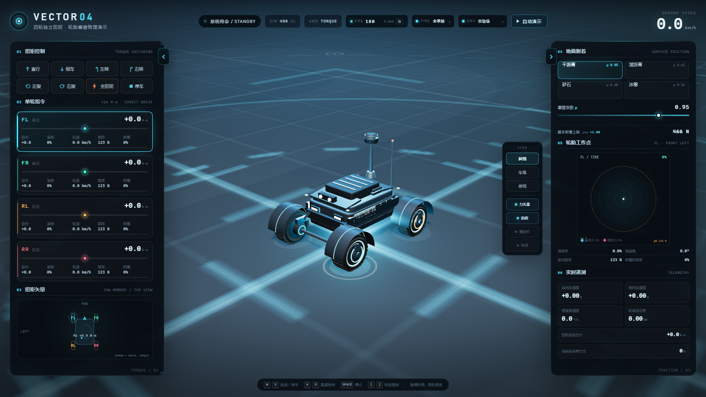
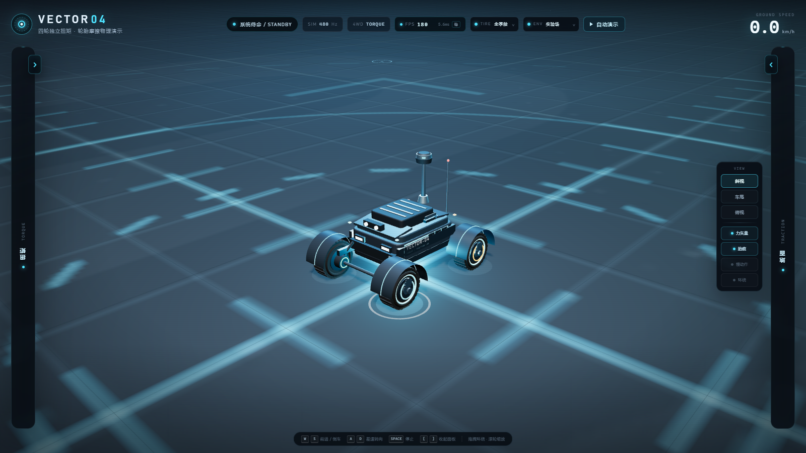
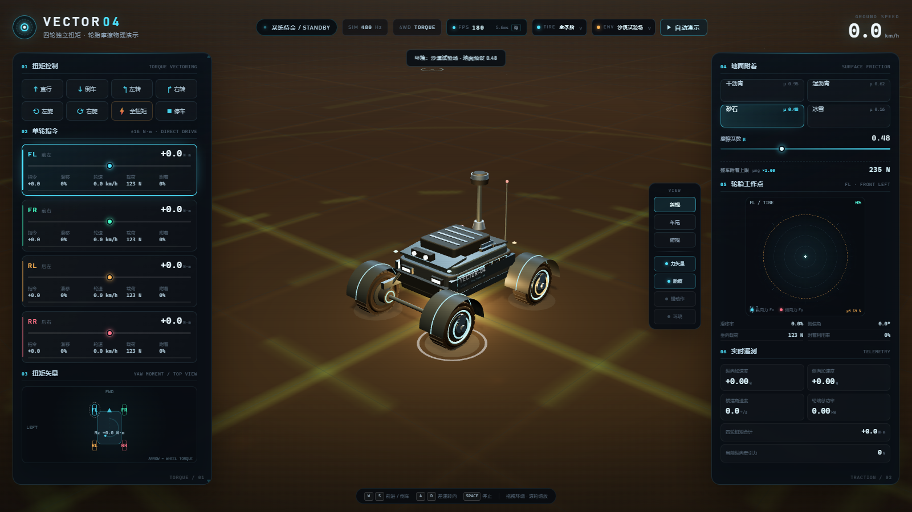
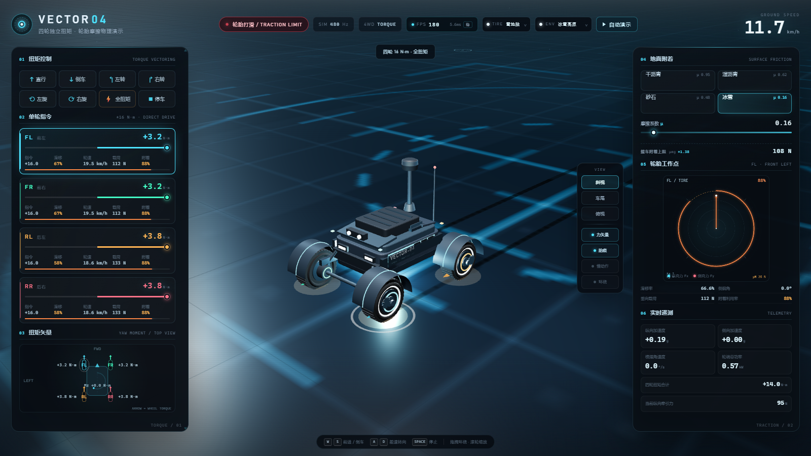

# VECTOR-04 · 四轮独立扭矩与轮胎摩擦演示

一个可以直接用浏览器打开的四轮机器人动力学演示。场地扩大到 **100 × 100 m**，内置 **6 种可切换轮胎配方** 和 **5 种环境**；四个车轮由四个轮毂电机独立驱动，每个车轮的扭矩可以单独给定。地面不是简单的“恒摩擦力”，而是按轮端载荷、滑移率、侧偏角、轮胎配方和摩擦圆实时计算。









上图为 **雪地胎 + 冰雪高原**（基础 μ = 0.16）的全扭矩工况：滑块指令为 +16 N·m，轮端实际扭矩约 +3.2 N·m，轮速约 19.5 km/h，车速约 11.7 km/h，滑移率约 67%。雪地胎把有效 μ 从 0.16 提升到约 0.221，但车轮仍然明显空转。

> 预览截图来自无头测试环境，未锁帧，所以顶栏 FPS 显示为 180；正常浏览器窗口会跟随显示器刷新率，通常显示 60 / 120 / 144。

## 快速开始

1. 双击 **`启动演示.cmd`**，或直接用 Edge / Chrome 打开 `index.html`。
2. 建议按 `F11` 全屏，窗口不小于 1366 × 768；最佳演示分辨率 1600 × 900 以上。
3. 不需要联网，不需要安装 Node.js；Three.js 已放在本地 `vendor/` 目录。
4. 场地为 **100 × 100 m**，在场地边缘（约 ±44 m）会自动回到中心。
5. 如果浏览器限制本地文件，可在本目录执行：
   ```bash
   python -m http.server 8080
   ```
   然后打开 `http://localhost:8080`。

## 演示操作

### 单轮扭矩

- 左侧四个滑块直接给定每个车轮的轮端扭矩，范围 **−16 N·m ～ +16 N·m**。
- 正扭矩驱动车辆向前，负扭矩可以是倒车、制动或反向扭矩。
- 每个车轮卡片显示：
  - **顶部大数字**：经过电机响应和转速限幅后的实际扭矩；
  - **指令**：滑块给定的目标扭矩；
  - **滑移**：纵向滑移率，超过 ±85% 时变红；
  - **轮速**、**垂向载荷**、**附着利用率**；
  - 底部细条：当前轮胎力占该轮 μN 附着极限的比例。

### 预设

| 预设 | 轮端扭矩（FL / FR / RL / RR） | 用途 |
|---|---|---|
| 直行 | +7 / +7 / +7 / +7 | 直线加速，观察后轴载荷增加 |
| 倒车 | −7 / −7 / −7 / −7 | 反向驱动 |
| 左转 | −4 / +12 / −4 / +12 | 左右扭矩差产生左转横摆力矩 |
| 右转 | +12 / −4 / +12 / −4 | 反方向差速 |
| 左旋 | −16 / +16 / −16 / +16 | 原地左旋，容易进入滑动区 |
| 右旋 | +16 / −16 / +16 / −16 | 原地右旋 |
| 全扭矩 | +16 / +16 / +16 / +16 | 观察干地/湿地/冰面的不同表现 |
| 停车 | 0 / 0 / 0 / 0 | 扭矩归零 |

### 键盘与鼠标

- `W` / `S`：前进 / 倒车
- `A` / `D`：差速转向；没有油门时自动变为原地旋转
- `Space`：扭矩归零
- 鼠标拖拽：环绕旋转相机
- 滚轮：缩放
- 双击场景：恢复默认斜视
- 右侧浮动工具条：斜视 / 车尾 / 俯视、力矢量、胎痕、慢动作、环绕展示
- 顶部 **TIRE** 下拉框：切换 6 种轮胎配方，可在行驶中直接切换
- 顶部 **ENV** 下拉框：切换 5 种环境
- 面板边缘的箭头标签：单独收起 / 展开左或右控制栏
- `[` / `]`：收起 / 展开左侧或右侧控制栏
- `H`：同时收起 / 展开两侧控制栏

### 控制栏收起

左右控制栏都可以收起到 **48 px 宽的竖向轨道**，不会丢失任何功能：

- 点击面板外侧的箭头标签即可收起或展开；
- 收起后仍能看到“扭矩 / 地面”竖向标签，点击标签也能展开；
- 右侧控制栏收起时，视角工具条会自动向屏幕右侧靠拢，给演示画面让出空间；
- 收起状态会保存在浏览器 `localStorage` 中，下次打开保持上次选择；
- 快捷键 `[`、`]` 控制单侧，`H` 同时控制两侧。

### 地面

- 四种真实参考材质：
  - 干沥青：μ ≈ 0.95
  - 湿沥青：μ ≈ 0.62
  - 砂石：μ ≈ 0.48
  - 冰雪：μ ≈ 0.16
- 也可以拖动 **μ** 滑块在 0.08 ～ 1.20 之间连续调节。
- 改变 μ 后，整车附着上限、每个车轮的 μN、轮胎力饱和程度都会实时变化。
- 场地上有中心标定圆、40 m 外圈、附加 Skid Pad 和 1 m 网格，方便观察车辆的实际移动距离。

### 轮胎配方

页面顶部的 **TIRE** 下拉框可以在 6 种配方之间切换。切换不会重置车辆状态，可以在行驶中直接对比抓地变化。

| 配方 | 干地 | 湿地 | 砂石 | 冰雪 | 峰值滑移 | 滚阻 |
|---|---:|---:|---:|---:|---:|---:|
| 全季胎 | ×1.00 | ×1.00 | ×1.00 | ×1.00 | 0.130 | 0.018 |
| 半热熔 | ×1.18 | ×0.80 | ×0.66 | ×0.52 | 0.145 | 0.021 |
| 雨胎 | ×0.90 | ×1.22 | ×0.74 | ×0.68 | 0.150 | 0.020 |
| 越野胎 | ×0.94 | ×0.86 | ×1.30 | ×0.92 | 0.170 | 0.026 |
| 雪地胎 | ×0.84 | ×0.96 | ×0.98 | ×1.38 | 0.160 | 0.028 |
| 光头胎 | ×1.30 | ×0.54 | ×0.48 | ×0.36 | 0.120 | 0.016 |

有效附着系数为：

```text
μ_eff = μ_地面 × k_轮胎(地面类型)
```

例如冰雪路面的基础 μ = 0.16，雪地胎倍率为 1.38，则有效 μ = 0.221。右侧“整车附着上限”会直接显示这个结果。

轮胎外观也会变化：

- 六种不同胎面：全季胎块、低扁平半热熔、宽排水雨胎、大块越野胎、细密雪地胎、无花纹光头胎；
- 胎侧配方识别环：全季青色、半热熔红色、雨胎蓝色、越野橙色、雪地白色、光头紫色。

### 环境

顶部 **ENV** 下拉框提供 5 种环境。环境只改变天空、光照、雾、地面色调和装饰，不改变车辆几何：

| 环境 | 推荐地面 | 视觉特征 |
|---|---|---|
| 实验场 | 干沥青 | 冷色实验室，青色轮廓光与标定圈 |
| 户外停车场 | 干沥青 | 灰色日光，暖色太阳，锥桶 |
| 沙漠试验场 | 砂石 | 暖色夕阳，砂土地面 |
| 冰雪高原 | 冰雪 | 冷蓝天空，低对比度雪原 |
| 夜间城市 | 湿沥青 | 深色天空，粉/青霓虹，湿地反射 |

切换环境时会：

- 自动把地面切换到该环境的推荐材质（仍可手动改回其他地面）；
- 清除旧胎痕，并取消正在运行的自动演示；
- 保留当前车辆位置、速度和轮胎配方；
- 平滑过渡光照、雾和地面色调；
- 户外停车场的锥桶仅作视觉参照，没有碰撞体。

### 自动演示

右上角 **自动演示** 会按 6 段脚本运行（使用当前选择的轮胎配方）：

1. 干沥青四轮等扭矩直线加速；
2. 左右差速扭矩转向；
3. 内外侧反向扭矩原地左旋；
4. 切换湿沥青，从中心全扭矩起步；
5. 切换冰雪，观察滑移率急剧升高；
6. 切断扭矩，观察轮胎力回落。

手动拖动滑块、按键盘或修改地面都会立即接管并退出自动演示。

## 流畅度自检

顶栏中间的 **FPS** 计数器是内置的实时流畅度自检：

- 数字：最近约 2 秒的平均帧率；
- `ms`：平均帧时间；
- 状态：
  - **稳**：帧率正常，帧时间分布均匀；
  - **微**：帧率略低或偶有轻微抖动；
  - **低**：平均帧率不足，通常是性能不够；
  - **卡**：平均帧率可能还可以，但 95% 分位/峰值帧明显变长，属于卡顿；
- 悬停可查看：平均帧率、平均帧时间、95% 帧时间、峰值帧时间、当前渲染分辨率；
- 点击 FPS 计数器可恢复最高渲染分辨率。

当帧率持续低于 46 FPS 时，程序会自动以 0.15 为步长降低内部渲染分辨率，最低 0.8×，所有功能、物理和交互保持不变；截图中的 180 FPS 是无头测试环境未锁帧的结果，正常窗口会跟随显示器刷新率。

这次优化针对了几个实际热点：

- 移除了覆盖在 WebGL 画布上的大面积 `backdrop-filter` 和全屏 `mix-blend-mode`，避免每帧重复模糊/混合；
- 每个车轮的胎块和辐条使用 `InstancedMesh`；六种胎面花纹预先构建，切换时只切换可见性；
- 520 条胎痕合并为单个 `InstancedMesh`，胎痕再多也只占 1 次 draw call；
- 阴影贴图从 2048 降到 1024，并改为 30 Hz 更新，静止时不重复渲染阴影；
- 渲染像素比上限从 2.0 降到 1.5，并带自动降级；
- 100 × 100 m 场地仍使用一张 2048 地面纹理和 1 m 网格，不增加额外 draw call；
- 环境切换只更新天空顶点颜色、灯光参数和可见性，不重建场景；
- 保留四轮独立扭矩、轮胎摩擦、车辆外观、键盘控制、侧边数据面板和自动演示。

本地 1600 × 900 无头 Edge + RTX 5060 的实测数据：

| 场景 | FPS | 平均帧时间 | draw call | 三角形 |
|---|---:|---:|---:|---:|
| 实验场静止，全季胎 | 180 | 5.6 ms | 150 | 19.0k |
| 冰雪高原全扭矩，雪地胎 | 180 | 5.6 ms | 158 | 19.4k |

测试中没有 JavaScript 异常。实际帧率以你机器顶栏的 FPS 读数为准。

## 推荐演示流程

1. **先看静止模型**：用鼠标环绕一圈，指出四个独立车轮、轮毂电机、LiDAR 和车架。
2. **直行 7 N·m**：讲解四个轮子等扭矩，车辆加速；观察后轴载荷从 123 N 升到约 130 N。
3. **左转 −4 / +12 N·m**：指出左右轮速差、横摆角速度和轮胎侧向力。
4. **全扭矩 + 冰面**：点击“冰雪”，再点“全扭矩”；观察轮速远高于车速、滑移率超过 100%、轮胎力达到摩擦圆边界。
5. **慢动作**：开启慢动作，观察接地点力矢量和摩擦圆矢量如何变化。
6. **自动演示**：作为开场或收尾，完整展示六段工况。

## 物理模型

模型是一个 **2.5D 车辆动力学模型**：车辆始终在平地上，考虑纵向、侧向和横摆三个车身自由度，以及四个车轮各自的转动自由度。

坐标约定：

- 车身 `x` 轴指向左，`z` 轴指向前，`y` 轴向上；
- 偏航角 `yaw > 0` 表示向左转；
- 车轮扭矩 `> 0` 表示驱动车辆向前。

### 车身运动

```text
u_dot = Fx / m + r · v
v_dot = Fy / m − r · u
r_dot = Mz / Iz
```

其中 `u` 为纵向速度，`v` 为侧向速度，`r` 为横摆角速度，`Mz` 为绕垂直轴的合力矩。

### 轮胎滑移

对每个车轮 `i`，接地点速度为：

```text
u_i = u − r · t_i
v_i = v + r · s_i
```

`s_i` 为车轮纵向位置，`t_i` 为横向位置（左正右负）。

纵向滑移率与侧偏角：

```text
κ_i = (ω_i · R − u_i) / max(|u_i|, 0.55)
α_i = atan2(v_i, max(|u_i|, 0.35))
```

归一化组合滑移：

```text
sx = κ / κ_peak
sy = tan(α) / tan(α_peak)
ρ  = sqrt(sx² + sy²)
```

轮胎力大小使用带峰值和动摩擦衰减的曲线：

```text
f(ρ) = sin(π/2 · ρ)                          , ρ ≤ 1
f(ρ) = 1 − 0.16 · (1 − 1/ρ)                  , ρ > 1

μ_eff = μ_地面 × k_轮胎(地面类型)

Fx =  μ_eff · N · f(ρ) · sx / ρ
Fy = −μ_eff · N · f(ρ) · sy / ρ
```

因此轮胎力不会无限增大，而是被限制在 **摩擦圆** 内；超过峰值滑移后还会轻微下降，模拟动摩擦。`κ_peak`、`α_peak` 也由当前轮胎配方决定。

### 垂向载荷转移

每个车轮的垂向载荷不是固定的 `mg/4`，而是：

```text
N_i = mg/4
    − sign(s_i) · m · a_x · h / (2L)
    − sign(t_i) · m · a_y · h / (2W)
```

- 加速时载荷向后轴转移；
- 制动时载荷向前轴转移；
- 转向时载荷向外侧车轮转移。

载荷会改变每个车轮的 `μN`，所以四个车轮的附着极限并不相同。

### 轮毂电机

```text
驱动时：τ_available = τ_max · (0.08 + 0.92 · (1 − |ω|/ω_max))
制动时：τ_available = τ_max
dτ/dt = (τ_cmd − τ) / 0.045
J · dω/dt = τ − Fx · R − τ_roll
```

- 电机扭矩不会瞬间建立，有一阶响应；
- 高转速时反电动势使可用驱动扭矩下降；
- 车轮转动惯量使“轮速”和“车速”可以不一致，于是自然出现 **空转** 和 **抱死趋势**；
- 轮胎对车身的反作用力同时作用在车轮上，形成闭环。

### 数值积分

- 固定步长 **1/480 s**；
- 每帧最多 48 个子步；
- 轮胎力使用 25 ms 松弛，低速时对滑移率/侧偏角做正则化；
- 静止且无指令时启用数值“睡眠”，避免缓慢蠕动。

### 主要参数

| 参数 | 值 | 含义 |
|---|---:|---|
| `mass` | 50 kg | 整车质量 |
| `wheelbase` | 0.72 m | 轴距 |
| `track` | 0.60 m | 轮距 |
| `wheelRadius` | 0.13 m | 车轮半径 |
| `wheelInertia` | 0.09 kg·m² | 单个车轮转动惯量 |
| `cgHeight` | 0.17 m | 重心高度 |
| `yawInertia` | 3.4 kg·m² | 横摆转动惯量 |
| `maxWheelTorque` | 16 N·m | 单轮峰值扭矩 |
| `maxWheelSpeed` | 48 rad/s | 空载轮速（约 22 km/h） |
| `peakSlip` | 0.13（全季胎） | 峰值纵向滑移率，按轮胎配方切换 |
| `peakSlipAngle` | 10°（全季胎） | 峰值侧偏角，按轮胎配方切换 |
| `rollingResistance` | 0.018（全季胎） | 滚动阻力，按轮胎配方切换 |
| `tireRelaxation` | 0.025 s | 轮胎力松弛时间 |

## 为什么湿地/冰面会打滑？

在干沥青上，全季胎单轮 `μN ≈ 0.95 × 123 ≈ 117 N`，四个轮子合计约 466 N；电机能提供的总驱动力低于或接近这个极限，所以轮胎基本能抓住地面。

切换到冰雪后基础 `μ ≈ 0.16`。全季胎单轮附着极限只剩约 18 N，四轮合计约 78 N；雪地胎把有效 μ 提升到约 0.221，单轮约 27 N，四轮约 108 N，但电机仍然可以输出几十牛米的轮端扭矩。车轮转动惯量很小，扭矩先把车轮加速，轮胎滑移率迅速升高，轮胎力在摩擦圆处饱和，多余的扭矩只能让车轮空转。这就是演示中“轮速约 19.5 km/h、车速约 11.7 km/h、滑移率约 67%”的来源。

## 修改参数

整车参数集中在 `js/physics.js` 顶部的 `DEFAULT_PARAMS`：

```js
const DEFAULT_PARAMS = {
  mass: 50,
  wheelbase: 0.72,
  track: 0.60,
  wheelRadius: 0.13,
  wheelInertia: 0.09,
  maxWheelTorque: 16,
  maxWheelSpeed: 48,
  // ...
};
```

轮胎配方集中在同一文件的 `TIRE_COMPOUNDS`：

```js
const TIRE_COMPOUNDS = {
  winter: {
    surfaceGrip: { dry: 0.84, wet: 0.96, gravel: 0.98, ice: 1.38 },
    peakSlip: 0.160,
    peakSlipAngle: 11.0 * Math.PI / 180,
    rollingResistance: 0.028,
    // ...
  },
  // allseason / sport / wet / offroad / slick
};
```

常见调整：

- **想要更快的加速**：提高 `maxWheelTorque`，或减小 `mass`；
- **想要更早打滑**：增大 `maxWheelTorque`、减小 `mass`，或降低 μ；
- **想要更大的最高车速**：提高 `maxWheelSpeed`；
- **想要更“软”的轮胎**：在 `TIRE_COMPOUNDS` 中增大 `peakSlipAngle`、减小 `peakSlip`；
- **想要更强的载荷转移**：提高 `cgHeight`；
- **想要更大的场地**：修改 `js/app.js` 中的 `GROUND_SIZE` 和 `ARENA_LIMIT`；
- **想要新的环境**：在 `js/app.js` 的 `ENVIRONMENTS` 中复制一项，修改天空、雾、灯光和 `groundTint`，即可出现在 ENV 下拉框中。

视觉颜色、相机和 HUD 布局在 `js/app.js` / `css/style.css` 中。

## 文件结构

```text
.
├─ index.html                 演示入口
├─ css/style.css              HUD 与响应式样式
├─ js/physics.js              四轮动力学 / 轮胎模型（可独立复用）
├─ js/app.js                  Three.js 场景、交互、遥测、自动演示
├─ vendor/three.min.js        本地 Three.js r152.2
├─ vendor/THREE-LICENSE.md    Three.js MIT 许可证
├─ tests/physics-test.js      物理自检
├─ 启动演示.cmd               双击打开演示
├─ preview.png                界面预览
├─ preview-collapsed.png      两侧控制栏收起预览
├─ preview-env.png            沙漠环境预览
├─ preview-ice.png            冰雪高原 + 雪地胎预览
└─ README.md
```

## 独立复用物理模型

`js/physics.js` 不依赖 Three.js，可以在自己的控制程序里单独使用。

浏览器：

```html
<script src="js/physics.js"></script>
<script>
  const sim = new RobotPhysics();

  // 四个车轮分别给定轮端扭矩，单位 N·m
  sim.setTorques([6, 6, 6, 6]);

  // 设置地面摩擦系数（可选第二参数指定地面类型）
  sim.setMu(0.62, 'wet');

  // 切换轮胎配方
  sim.setTireType('winter');

  // 视觉环境（同时设置推荐地面）
  window.__VECTOR__ && window.__VECTOR__.setEnvironment('snow');

  // 以 480 Hz 推进
  for (let i = 0; i < 480; i++) sim.step(1 / 480);

  const t = sim.getTelemetry();
  console.log(t.speedKmh, t.tireName, t.mu, t.wheels[0].slipPercent);
</script>
```

Node.js：

```js
const { RobotPhysics } = require('./js/physics.js');
const sim = new RobotPhysics();
sim.setMu(0.16, 'ice');
sim.setTireType('winter');
sim.setTorque(0, 8);       // FL
sim.setTorque(1, 8);       // FR
sim.setTorque(2, 0);       // RL
sim.setTorque(3, 0);       // RR
for (let i = 0; i < 480; i++) sim.step(1 / 480);
console.log(sim.getTelemetry());
```

## 物理自检

如果本机有 Node.js：

```bash
node tests/physics-test.js
```

当前自检覆盖：静止、扭矩跟随、加速、高速扭矩衰减、纵向载荷转移、冰面滑移、差速转向、原地旋转、负扭矩制动、摩擦圆限幅、垂向载荷守恒，以及雪地胎/光头胎的附着变化和切换轮胎不重置车辆状态。

## 模型边界

这是一个面向演示和教学的可交互模型，不是经过实车标定的轮胎/整车仿真：

- 100 × 100 m 平地，不包含坡度、台阶、越障和悬架行程；
- 没有转向几何和轮胎回正力矩；
- 轮胎模型是简化的组合滑移曲线，不是完整的 Pacejka 魔术公式；
- 六种轮胎配方是基于演示经验的倍率参数，不是某一款真实轮胎的实测数据；
- 五种环境是视觉与推荐地面预设，环境装饰没有碰撞体；
- 没有轮胎温度、胎压、磨损、电机温度、电池电压跌落和控制器电流环；
- `μ` 被视为峰值附着系数，没有单独区分静摩擦/动摩擦；
- 如需用于真实机器人控制器设计，建议用实车轮胎数据重新标定，并加入电机电流/电压限制、编码器噪声、通信延迟和更完整的悬架模型。

## 第三方

- Three.js r152.2，MIT License，见 `vendor/THREE-LICENSE.md`。
